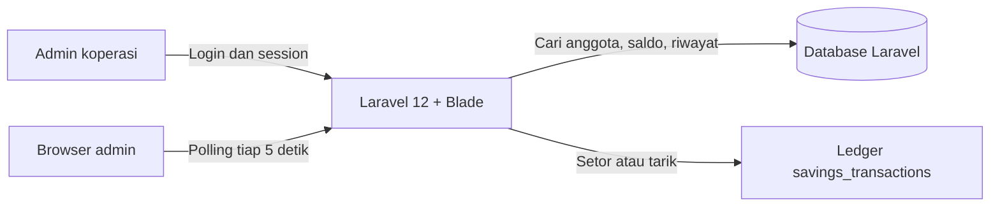

# Panduan Program Koperasi Harmoni

**Diperbarui:** 21 Oktober 2026

Dokumen ini menjelaskan aplikasi yang aktif di root repository. Fokus web saat ini adalah satu halaman admin untuk mengelola tabungan anggota. Folder `koperasi-digital-monorepo/` tetap merupakan prototipe terpisah.

## 1. Gambaran aplikasi



Halaman `/admin` mempertahankan UI daftar anggota berbentuk kartu: pencarian, filter status, jumlah anggota, dan grid kartu. Informasi pinjaman pada kartu diganti dengan saldo tabungan dan transaksi terakhir. Kartu menyediakan aksi Setor, Tarik, dan Detail. Detail membuka formulir transaksi beserta riwayat anggota. Setiap setoran/penarikan wajib memilih kategori Pokok, Wajib, atau Sukarela.

## 2. Autentikasi dan halaman

| Path | Akses | Fungsi |
|---|---|---|
| `GET /` | Publik | Mengarahkan ke halaman login. |
| `GET /login`, `POST /login` | Publik | Form login dan autentikasi session. Login hanya menerima role admin/master admin. |
| `POST /logout` | Session | Mengakhiri sesi admin. |
| `GET /admin` | Admin | Daftar anggota dan saldo tabungan. Mendukung parameter `search`, `status`, dan `page`. |
| `GET /admin/savings/snapshot` | Admin | Mengembalikan saldo dan transaksi terakhir untuk kartu yang sedang ditampilkan. Menerima `ids[]`. |
| `GET /admin/savings/{customer}` | Admin | Saldo keseluruhan, total tiap kategori, dan riwayat sesuai filter query `category` (HISTORY, POKOK, WAJIB, SUKARELA); 20 transaksi per halaman. |
| `POST /admin/savings/{customer}` | Admin | Mencatat setoran/penarikan dengan kategori `POKOK`, `WAJIB`, atau `SUKARELA`. Dilindungi session dan CSRF Laravel. |
| `GET /api/health` | Publik | Health check API. Route API bisnis lama telah dinonaktifkan. |

`/dashboard` hanya menjadi redirect kompatibilitas ke `/admin`. Route `/member/*`, `/workspace/*`, halaman pengelolaan karyawan, pinjaman, validasi, dan riwayat lama sudah tidak tersedia.

## 3. Alur setoran dan penarikan

1. Admin membuka kartu anggota atau mencari berdasarkan nama/kode anggota.
2. Admin memilih Setor atau Tarik, memilih kategori Pokok/Wajib/Sukarela, mengisi nominal, lalu dapat menambahkan catatan.
3. Browser mengirim request JSON dengan token CSRF dan UUID idempotensi.
4. `AdminSavingsController` memvalidasi jenis transaksi, nominal, dan UUID.
5. `SavingsLedgerService` mengunci record anggota dalam transaksi database, membaca saldo keseluruhan dan saldo kategori, memeriksa aturan, lalu menulis ledger.
6. UI menampilkan saldo baru dan memuat ulang riwayat anggota.

Aturan ledger:

- Jenis transaksi adalah `DEPOSIT` atau `WITHDRAWAL`.
- Nominal harus positif dengan maksimal dua angka desimal.
- Setoran hanya dapat dicatat untuk anggota `ACTIVE`.
- Penarikan tidak dapat melebihi saldo keseluruhan maupun saldo pada kategori yang dipilih.
- Total kategori adalah jumlah setoran dikurangi jumlah penarikan pada kategori itu.
- Saldo awal dihitung nol jika anggota belum memiliki transaksi. Program tidak membuat saldo awal dari histori pinjaman/pembayaran.
- Transaksi yang sudah ada sebelum kolom kategori ditambahkan tetap berkategori kosong. Baris lama tetap masuk saldo keseluruhan dan tampilan Riwayat; baris tersebut tidak dialokasikan ke kategori secara otomatis.
- Pengiriman ulang UUID yang sama untuk payload transaksi sama mengembalikan transaksi sebelumnya; UUID yang dipakai dengan payload berbeda ditolak.
- Jumlah disimpan sebagai decimal dua angka; service menghitung saldo dalam satuan sen di dalam prosesnya.

## 4. Pembaruan data

Browser meminta snapshot saldo untuk anggota pada halaman setiap lima detik. Endpoint memperbarui saldo, badge status, dan transaksi terakhir pada kartu. Jika modal detail terbuka, saldo dan halaman riwayat modal juga dimuat ulang. Ini pembaruan berkala melalui HTTP; aplikasi belum menggunakan WebSocket atau server-sent events.

## 5. Data utama

| Tabel | Fungsi |
|---|---|
| `customers` | Profil anggota, kode, status, pekerjaan, dan alamat. Data ini tetap menjadi sumber daftar anggota. |
| `users`, `roles` | Akun pencatat dan role; akun admin login ke aplikasi. Akun lama tetap tersimpan untuk menjaga relasi histori. |
| `savings_transactions` | Ledger setoran/penarikan, kategori tabungan (nullable untuk transaksi lama), nominal, saldo keseluruhan setelah transaksi, UUID idempotensi, kode referensi, admin pencatat, catatan, dan waktu. |
| `loans`, `payments`, tabel domain lain | Data historis yang tetap disimpan, tetapi route operasional terkait tidak aktif pada aplikasi saat ini. |

Relasi `savings_transactions.customer_id` mengarah ke anggota; `recorded_by` mengarah ke akun pencatat. Foreign key membatasi penghapusan anggota atau akun yang sudah punya transaksi tabungan.

Migration adalah sumber kebenaran skema Laravel. Ledger dibuat oleh `database/migrations/2026_10_21_000001_create_savings_transactions_table.php`; kategori ditambahkan secara aman oleh `database/migrations/2026_10_21_000002_add_category_to_savings_transactions.php` tanpa mengubah transaksi lama.

## 6. Akses akun dan data anggota

- Seeder standar mengimpor data anggota jika `database/data/members.csv` tersedia dan membuat `admin@koperasi.id` dengan password pengembangan `password`.
- Seeder tidak lagi membuat akun demo master admin, collector, atau anggota.
- Login menolak akun non-admin yang mungkin masih ada dari penggunaan sebelumnya. Route registrasi, provisioning, dan API bisnis tidak aktif.
- Record akun lama sengaja dipertahankan agar data anggota, transaksi, pinjaman, pembayaran, dan audit tetap berelasi. Akun itu tidak dapat memakai aplikasi web ini.
- Data anggota asli tidak ada di Git karena memuat informasi pribadi.

## 7. Menjalankan secara lokal

Gunakan PowerShell dari root repository. Prasyarat PHP 8.2+, Composer, Node.js, dan npm.

```powershell
composer install
if (-not (Test-Path .env)) { Copy-Item .env.example .env }
php artisan key:generate
if (-not (Test-Path database/database.sqlite)) { New-Item -ItemType File database/database.sqlite | Out-Null }
npm ci
php artisan migrate --seed
npm run build
php artisan serve
```

Buka `http://127.0.0.1:8000/login`; akun seed adalah `admin@koperasi.id` / `password`. Ubah password sebelum aplikasi dipakai bersama.

Untuk mengimpor file anggota secara manual:

```powershell
php artisan members:import database/data/members.csv
```

Gunakan `database/data/members.example.csv` untuk melihat format kolom. Periksa konfigurasi database di `.env` sebelum menjalankan migration; SQLite adalah konfigurasi development yang umum pada repository ini.

## 8. Peta source code

| Lokasi | Isi |
|---|---|
| `routes/web.php` | Halaman login, logout, dashboard admin, dan endpoint savings. |
| `routes/api.php` | Health check API. |
| `app/Http/Controllers/DashboardController.php` | Pencarian/filter anggota dan snapshot saldo. |
| `app/Http/Controllers/AdminSavingsController.php` | Riwayat transaksi dan endpoint pencatatan. |
| `app/Services/SavingsLedgerService.php` | Aturan saldo, lock database, idempotensi, dan penulisan ledger. |
| `app/Models/Customer.php`, `SavingsTransaction.php` | Model anggota dan transaksi tabungan. |
| `resources/views/dashboard.blade.php` | Halaman kartu anggota, form, riwayat, dan polling browser. |
| `resources/views/login.blade.php` | Halaman login admin. |
| `database/seeders/` | Role, permission, admin development, serta impor anggota lokal. |
| `database/data/members.example.csv` | Contoh struktur CSV anggota tanpa data asli. |

## 9. Prototipe terpisah

`koperasi-digital-monorepo/` berisi prototipe React/Vite, Express/TypeScript, Prisma, package bersama, rancangan desktop Tauri, dan firmware ESP32. Folder tersebut belum dihubungkan dengan login, route, ledger, atau database Laravel. Skema dan endpoint di dalamnya bukan sumber data aplikasi admin saat ini.

## 10. Batasan saat ini

- Auto-refresh lima detik dapat menampilkan transaksi baru dengan sedikit jeda.
- Saldo awal tidak diimpor dari sumber lain. Riwayat tabungan lama tetap ada sebagai transaksi tanpa kategori: masuk saldo keseluruhan tetapi tidak masuk total kategori.
- Halaman member dan karyawan telah dihapus dari route dan view. Data lama tetap disimpan.
- Route API bisnis lama dinonaktifkan; `/api/health` adalah satu-satunya route API aktif.
- Saat perubahan ini dibuat, test suite tidak dijalankan. Kompilasi Blade, build Vite, daftar route, dan pemeriksaan sintaks PHP berhasil.

Untuk ringkasan status lihat [PROJECT_STATUS.md](PROJECT_STATUS.md). Migration menjadi acuan skema; dokumen desain lama tetap berguna sebagai referensi historis, bukan daftar route aktif.
