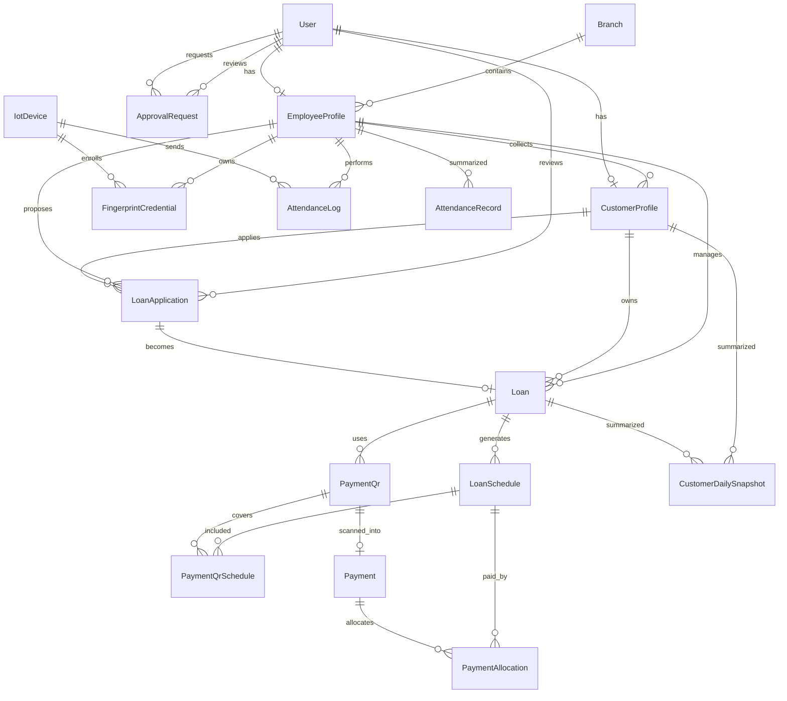

# ERD Koperasi Digital

Skema ini mengoptimalkan siklus pinjaman 60 hari, scan QR harian, dashboard tunggakan, dan absensi IoT real-time.

## Diagram Mermaid

## Tabel Inti

| Tabel | Fungsi | Catatan Kunci |
|---|---|---|
| `User` | Login dan role global | Role: Nasabah, Karyawan, Admin, Master Admin |
| `EmployeeProfile` | Data karyawan/penagih/admin operasional | Dipakai untuk collector, supervisor, fingerprint |
| `CustomerProfile` | Data nasabah dan usaha | Menyimpan collector pilihan dan koordinat Google Maps |
| `LoanApplication` | Pengajuan pinjaman | Berisi analisis kelayakan 60 hari |
| `Loan` | Pinjaman aktif | Memiliki `termDays=60`, nominal, status, collector |
| `LoanSchedule` | Jadwal tagihan harian | 60 baris per pinjaman, Minggu tidak dibuat |
| `PaymentQr` | QR dinamis penagihan | Mode 1 hari, 2 hari, akumulasi tunggakan, custom |
| `PaymentQrSchedule` | Relasi QR ke jadwal | Membuat QR bisa melunasi banyak hari |
| `Payment` | Hasil scan QR nasabah | Cash/transfer tetap wajib scan |
| `PaymentAllocation` | Alokasi pembayaran | Memecah payment ke satu/banyak jadwal |
| `CustomerDailySnapshot` | Cache dashboard | Streak, hari tunggakan, warna risiko |
| `ApprovalRequest` | Validasi admin | Untuk aktivasi nasabah, update data, CRUD karyawan |
| `IotDevice` | Perangkat ESP32/fingerprint | Menyimpan device code dan status |
| `FingerprintCredential` | Mapping sidik jari | Hindari menyimpan biometric raw jika tidak wajib |
| `AttendanceLog` | Event mentah IoT | Immutable audit log dari perangkat |
| `AttendanceRecord` | Ringkasan harian | Warna kalender absensi |

## Color Coding Pinjaman

| Warna | Kondisi | Nilai `riskColor` |
|---|---|---|
| Biru | Tidak ada tunggakan | `BLUE` |
| Kuning | Tunggakan 1-2 hari | `YELLOW` |
| Merah | Tunggakan 3-9 hari | `RED` |
| Hitam/Merah Gelap | Tunggakan lebih dari 10 hari | `DARK` |

## Color Coding Absensi

| Warna | Kondisi | Status |
|---|---|---|
| Biru | Empat slot absen lengkap | `COMPLETE` |
| Kuning | Ada absen, tetapi tidak lengkap | `PARTIAL` |
| Merah | Tidak ada absen sama sekali | `ABSENT` |

## Aturan Optimasi

- `LoanSchedule` adalah sumber utama tagihan harian, bukan hasil hitung sementara di frontend.
- `PaymentQrSchedule` membuat QR tetap auditable karena jadwal yang dibayar terekam eksplisit.
- `CustomerDailySnapshot` boleh di-rebuild dari `LoanSchedule` dan `PaymentAllocation`, sehingga aman untuk caching dashboard.
- `AttendanceLog` tidak diubah setelah masuk; koreksi dilakukan pada `AttendanceRecord` dengan audit trail.
